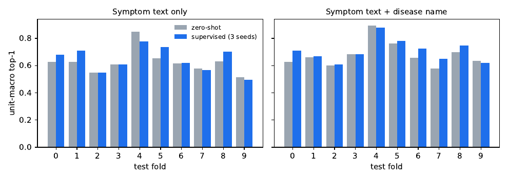

<div align="center">

# Beyond Disease Labels

### Symptom-based vision-language learning for unseen plant diseases

**Amirreza Zibafar** · Independent researcher

[[`Paper`](paper/main.pdf)] [[`Code`](https://github.com/AmirrrezaZ/plant-diagnose-anything)] [[`Annotations`](data/annotation)] [[`BibTeX`](#citation)]

</div>

<p align="center">
  
</p>

Plant-disease classifiers normally output disease *names*, so they cannot handle a disease that is not in their training set. This work instead learns to read visual *symptoms* (affected part, colour, texture, shape, pattern, lesion density) from a photograph and matches the image to **text descriptions of symptoms**. A new disease only needs a symptom description, not new training images.

The repository contains the method (LoRA adaptation of the vision and text towers of SigLIP 2), the evaluation protocol (10-fold CV in which every disease is held out once, plus external farmer-photo tests), all baselines and controls, the symptom annotations used to train and evaluate, trained adapters, and an inference script. The annotations are a supporting resource; the contribution of the paper is the method and its evaluation.

## Highlights

- **Image to symptom transfer.** A linear head trained on seen diseases predicts the symptoms of *held-out* diseases better than a same-crop prior on all six attributes (clearly for affected part, shape and pattern).
- **Joint vision + text LoRA** (`scripts/v6_joint.py`) improves held-out-disease top-1 over its own zero-shot start (3 seeds, 10-fold CV, 95% fold-bootstrap intervals):

| text used to score a held-out disease | zero-shot | joint LoRA | gain |
|---|---|---|---|
| description built from the disease's images | 0.625 | 0.684 | +0.059 [+0.023, +0.092] |
| description written blind by an LLM from the name | 0.561 | 0.609 | +0.048 [+0.011, +0.083] |
| blind tag list | 0.490 | 0.582 | +0.092 [+0.053, +0.136] |
| disease-name prompt | 0.638 | 0.656 | +0.018 [-0.008, +0.043] |

- **Honest limits.** On an external 423-image, 39-disease farmer-photo test (DigiGreen) the gains are positive but not significant (+0.02 to +0.03, intervals include zero), disease-name prompts are still stronger there, and texture and lesion density are not read better than a most-common-value prior. See the paper's limitations section.

## Installation

```bash
git clone https://github.com/AmirrrezaZ/plant-diagnose-anything.git
cd plant-diagnose-anything
python -m venv venv && source venv/bin/activate
pip install torch==2.2.2 torchvision==0.17.2 transformers==4.56.1 peft==0.21.2 \
            numpy==1.26.4 pandas==2.3.3 pillow==11.3.0
```

Tested with these versions on NVIDIA GPUs (training used 24 GB cards; inference runs on a single GPU or CPU). The SigLIP 2 backbone `google/siglip2-large-patch16-256` is downloaded from Hugging Face on first use.

## Getting started

### Rank candidate diseases for a photo

Candidates are described by symptoms (values from `data/annotation/vocab.json`) or by free text:

```json
[
  {"name": "early blight", "affected_part": ["leaf"], "color": ["brown"], "shape": ["concentric_target"], "pattern": ["halo"]},
  {"name": "late blight",  "text": "a photo of a tomato leaf with dark water-soaked lesions"}
]
```

```bash
python scripts/v6_infer.py \
    --ckpt checkpoints/JDG_fold-1_s0.pt \
    --image leaf.jpg --crop tomato \
    --candidates cands.json            # add --use_name to also score disease names, --zero_shot for the unadapted model
```

The script prints the ranked candidates with probabilities. The checkpoint holds the LoRA weights for both towers and the logit scale and bias.

### Checkpoint (GitHub Release)

The released model is the **joint vision + text LoRA** (the best setting in the paper), trained on all PlantWild diseases that do not match a DigiGreen type. Download it from the [latest release](https://github.com/AmirrrezaZ/plant-diagnose-anything/releases/latest) into `checkpoints/`:

| file | content |
|---|---|
| `JDG_fold-1_s0.pt` | joint LoRA, seed 0 (about 25 MB). Use this by default. |
| `JDG_fold-1_s1.pt`, `JDG_fold-1_s2.pt` | seeds 1 and 2, for seed ensembling |

The adapters hold LoRA weights for both SigLIP 2 towers plus the logit scale and bias. Per-fold cross-validation checkpoints and the vision-only or text-only variants are not released; the CV numbers in the paper can be checked from `results/` and regenerated with the commands below.

## Data

| path | content |
|---|---|
| `data/annotation/annotations.csv`, `vocab.json` | symptom annotations for 20,942 PlantWild photographs, 120 (crop, disease) units, 6 attributes, 42 values (group-level tags; see the paper for the annotation procedure and its limits) |
| `data/split/` | 10-fold unit-grouped CV splits (`cv0`..`cv9` = train / val / test) |
| `data/profiles/` | symptom profiles written blind by an LLM from crop + disease name only |
| `data/external/` | DigiGreen to PlantWild mapping used for the matched test |

**Images are not redistributed.** PlantWild (CC BY-NC-ND) and DigiGreen (CC-BY-4.0) must be obtained from their sources; `annotations.csv` carries `orig_path` for matching.

## Repository layout

```
scripts/     training, evaluation, baselines, controls, paper-asset generation
configs/     exact commands for the final configurations
data/        annotations, splits, blind profiles, external mappings
checkpoints/ (download from the Release) LoRA adapter
logs/        training logs of the runs in the paper
notes/       experiment log and text-side experiment notes
docs/        project web page (GitHub Pages)
results/     result files (CV folds, controls, per-attribute probes, DigiGreen)
paper/       LaTeX source, tables, figures, compiled PDF
```

## Reproducing the paper

1. Obtain the images (see Data) and put them under `data/` as expected by `scripts/`.
2. Text embeddings: `python scripts/v6_text.py`, and for blind profiles `python scripts/v6_llm_profiles.py` then `python scripts/v6_text_llm.py`.
3. Joint model: `bash scripts/q_joint.sh <gpu> J0 "0 1 2 3 4 5 6 7 8 9" --seed 0` (repeat for seeds 1 and 2 with tags `J1`, `J2`); DigiGreen model: `python scripts/v6_joint.py --fold -1 --steps 400 --tag JDG --seed 0`.
4. Evaluation extras: `scripts/v6_attr_eval.py` (image to symptom transfer), `scripts/v6_joint_attr.py` and `scripts/v6_vision_attr.py` (per-attribute probes), `scripts/v6_controls.py`, `scripts/v6_bcvsa.py`, `scripts/v6_vlm.py` (baselines and controls).
5. Tables and figures: `python scripts/make_paper_assets.py && python scripts/make_paper_assets2.py`, then build `paper/main.tex`.

Experiment bookkeeping is in `notes/EXPERIMENT_LOG.md`, `notes/TEXT_SIDE_EXPERIMENTS.md` and the run index `experiments_index.csv`.

## License

Code: MIT (`LICENSE`). Annotations, splits and profiles in `data/`: CC BY 4.0 (`LICENSE-DATA`). The annotation files contain no images. The photographs belong to PlantWild (CC BY-NC-ND) and DigiGreen (CC BY 4.0) and must be obtained from their sources under their licenses.

## Citation

```bibtex
@misc{zibafar2026beyond,
  title        = {Beyond Disease Labels: Symptom-Based Vision-Language Learning for Unseen Plant Diseases},
  author       = {Zibafar, Amirreza},
  year         = {2026},
  doi          = {10.5281/zenodo.24032335},
  howpublished = {\url{https://github.com/AmirrrezaZ/plant-diagnose-anything}}
}
```

## Acknowledgements

Built on [PlantWild](https://arxiv.org/abs/2408.03120), [DigiGreen Crop Disease Expert Annotations](https://huggingface.co/datasets/DigiGreen/Crop_Disease_Images), [SigLIP 2](https://arxiv.org/abs/2502.14786) and [PEFT](https://github.com/huggingface/peft). Blind profiles were written with Qwen2.5-VL-7B-Instruct, and annotation was LLM-assisted.

## License

A license has not been chosen yet. Note that the underlying datasets carry their own licenses (PlantWild: CC BY-NC-ND; DigiGreen: CC-BY-4.0).
